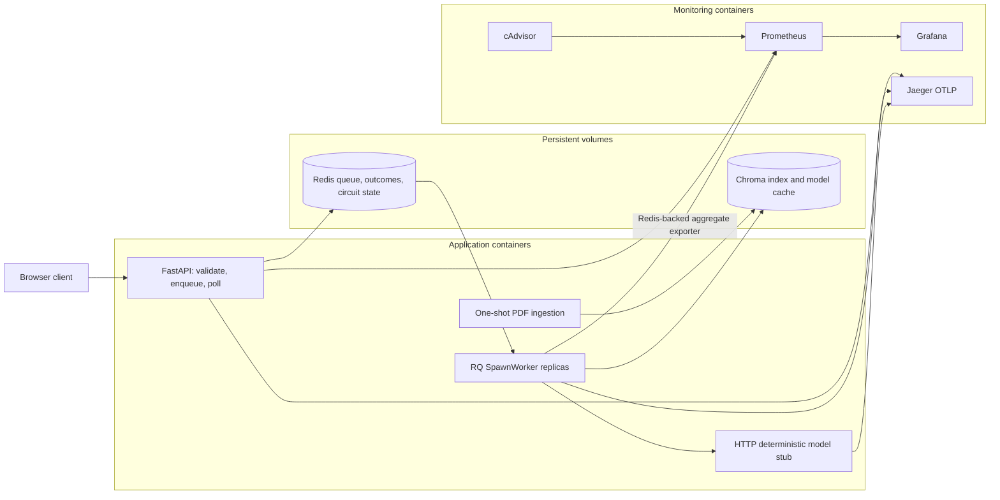

# Securities Investor Grievance Routing — demonstration report

**Historical November 11 report.** Current integrated implementation, repaired
gaps and new measured evidence are in [COMPLETION_STATUS.md](COMPLETION_STATUS.md).
The original decisions/architecture below are retained as development history.

Updated 2026-11-11. This report describes the implemented demo and its limits;
PROJECT_AUDIT.md distinguishes working integrations from planned/helper code.

## Problem and scope

Investment vocabulary and the regulator named by a complainant can suggest the
wrong route. The reference bank fixed-deposit interest complaint names SEBI, but
the reviewed evidence supports the RBI framework and a prior written complaint
to the bank. This system assists grievance-officer triage; it does not decide a
complaint, award compensation or contact regulators.

The active corpus contains three hash-verified PDFs in `corpus/raw/`. Exact
reviewed sections supplement overlapping page chunks. Archive PDFs are excluded.
See CORPUS_CONFIRMATION.md and corpus/SOURCES.md for the reviewed interpretation
and known historical-corpus limitations. This report introduces no new citations.

## Deployment and agent design

The investigator reads validated fields, performs semantic search, identifies
the product/entity, checks the SCORES modifier and retrieves reviewed clauses.
Its explicit LangGraph state hands a hypothesis, retrieved evidence and tool
events to the verifier. The verifier checks required coverage and exact quote/
metadata equality against the index before constructing the route. The current
tool policy is programmed and hypothesis-dependent; it is not a general LLM
planner. Unrecognized, split or unsupported cases escalate. The current graph
has one node per agent and no verifier-to-investigator retry edge.

Queueing isolates request handling from expensive processing. SpawnWorker
isolates native Chroma state per job, at the cost of per-job initialization.
Separate ingestion, shared immutable index, Redis and scalable workers permit
independent startup/recovery. Monitoring containers can fail independently of
valid processing. Jaeger context crosses Redis, and logs correlate trace/run IDs.
No complaint bodies are added to exported spans or metric labels.

## Decisions and rejected shortcuts

- Kept reviewed PDFs and bank-first eligibility rules; did not invent excerpts
  or replace evidence with keyword-only citations.
- Used a deterministic HTTP stub to measure our system without API keys,
  provider throttling or variable model response times.
- Measured the complete asynchronous lifecycle, not just fast enqueue latency.
- Kept the declared eight-second p95 target even when a measured case misses it.
- Preserved process isolation and existing data instead of changing regulatory
  logic, disabling monitoring or deleting queues/indexes to improve a benchmark.
- Kept benchmark artifacts outside source control and documented actual local
  results with explicit sample-size and shared-machine limits.

## Verification, performance and cost

Host and freshly built Python 3.11 container suites each passed 67 tests during
Phase 4 completion. Coverage includes original corpus/routing/API regressions,
reliability, lifecycle timing/validation and restarted-worker health. See
PHASE4_REPORT.md for the real Compose benchmark, p50/p95, throughput, tested
failure boundary, scaling effect, bottleneck evidence and final smoke checks.
The eight-second SLO was recorded in PHASE4_SLO.md before load measurements.

There are no external model API charges for the local stub: external-model cost
per 100 benchmark runs is zero. This excludes electricity, device resources,
developer time and infrastructure costs, which were not priced. Real-provider
token/cost claims would be unsupported: the cost helper is not wired into model
calls. CPU/process initialization must be assessed using measured runtime data,
not converted into invented billed-token figures.

The teammate's 21-scenario `eval/eval_results_v2.json` stores perfect scores under
its current proxy definitions. The runtime does not select the v1/v2 YAML prompts;
the evaluation version argument only labels the output. Therefore this report
does not claim a validated before/after prompt improvement. Independent stronger
evidence-based metrics and actual prompt selection remain work for Phase 3.
The November 11 read-only container rerun reproduced the 21 stored proxy scores;
the dataset was explicitly mounted because the default image does not package it.

## What did not work and what remains

A restored Redis worker registration caused repeated worker startup failure after
Docker resumed. Unique worker incarnation names and heartbeat-scoped readiness
fixed the collision without deleting persistent state; see INCIDENT_LOG.md.

The stub understands a bounded set of reference patterns, not arbitrary investor
complaints. Remaining integrations include all-field/output guardrails,
verification re-search, genuine prompt comparison, runtime cost/caching/rate
limiting, feedback/quality aggregation and complete prompt/cost trace audit.
See PROJECT_AUDIT.md for evidence and priorities. Production authentication and
deployment hardening are outside this college demo's current scope.

## Reproduction and demonstration

README.md provides clean-start commands and URLs. RUNBOOK.md covers model outage,
queue saturation, restart recovery and load/scaling commands. For the demo:
start Compose; show the verified bank FD result and bank-first advice; inspect
exact citations and the linked Jaeger trace; show invalid-input rejection and
uncertain escalation; demonstrate provider circuit recovery on an idle stack;
then present the actual Phase 4 table and its limits. State the repository audit
gaps candidly instead of presenting every planned feature as integrated.
