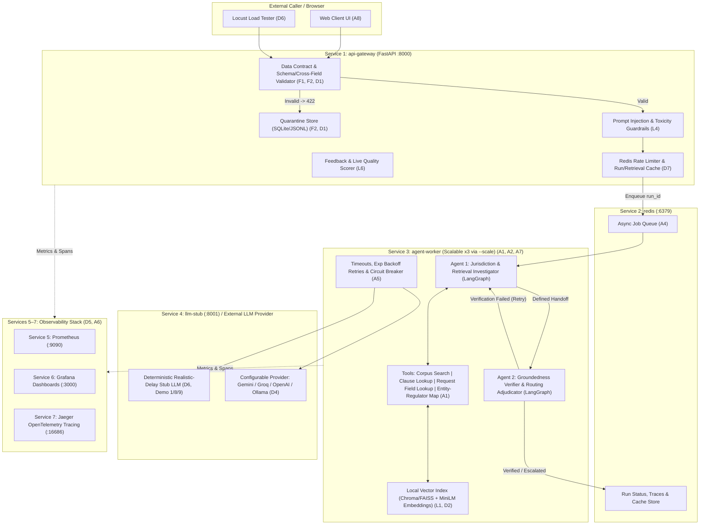

# Implementation Plan — Securities Investor Grievance Routing Service (Mini Project 12)

> [!CAUTION]
> **Revision 3 (29 Oct, 08:52): corpus verified. These notes override §2 below.** The authoritative clause list is [`corpus/SOURCES.md`](../../corpus/SOURCES.md).
> - Corpus = SCORES circular 2023/156 + **SEBI MF Regulations 1996** (user decision, last amended 01 Nov 2025) + RBI-IOS 2021 (amended to Aug 2022).
> - Correct references: SCORES **para 1.2** (21 days) and **para 5.3** (RBI exclusion); RBI-IOS **cl. 3(1)(f), 3(1)(j), 8(1), 9** (grounds) and **10(2)(a)** (30-day / 1-year rule); MF Regs **Reg 53** and **Reg 60A**.
> - **Wrong in §2 below:** "Clause 10" for the SCORES exclusion (it's para 5.3); RBI "Clause 8 grounds" (it's cl. 9); the claim that RBI-IOS lists fixed deposits or interest by name (it doesn't); the MF "3 / 5 / 7 working days, 15%" figures (not in the 1996 regulations).

> [!IMPORTANT]
> **Revision 2: now checked against your uploaded PDFs.** The first version was written before I could read the problem statement, glossary and index PDFs. I've since extracted their text and checked the plan against them. The corrections:
> - **Prioritisation is graded.** The spec says *"Completing all 22 requirements is not expected; sound prioritisation is itself assessed"*, and a system that doesn't start and serve a valid request at the demo gets **zero marks**. The phases (§5) are now ordered so a working end-to-end path comes first.
> - **The corpus must be the real documents.** The clause numbers, circular IDs and timelines in §2 came from memory and are **unverified**. They will be confirmed against the downloaded PDFs. I will not write or paraphrase regulation text myself.
> - **L3** needs **≥20** scenarios. I had written 22, mixing it up with the 22 requirements. We'll target 20–22.
> - **D5** needs **per-container resource utilisation**, so cAdvisor is added. **D4** bans model identifiers in the repo, so the embedding and LLM model names go in `.env` too. **D3** says *nothing runs outside containers*, so the ingest and eval CLIs run via `docker compose run`.
> - **Evaluation 1 deliverable added:** a corpus confirmation doc showing the passages the §4.1 case depends on and the test values.

This plan transforms the existing scaffold repository (`securities-investor-grievance-routing`) into a complete, production-grade multi-agent RAG and AgentOps system satisfying **Functional (F1–F8)**, **Agent System (A1–A8)**, **LLMOps (L1–L6)**, **Platform & Deployment (D1–D8)** requirements, and all **10 Live Demonstration** scenarios.

---

## 1. System Architecture & Deployment Boundaries (`D3`, `A2`, `A4`, `A7`, `D5`)

All components run inside Docker Compose from a single `docker compose up --build` command on a clean clone, with declared health checks and dependency ordering.



### Justification of Deployment Boundaries (`D3`)
1. **`api-gateway` (`:8000`)**: Lightweight, I/O-bound HTTP ingestion boundary enforcing data contracts, guardrails, rate limiting, and quarantine before any compute-heavy agent work begins. Scales independently for high request ingestion throughput.
2. **`agent-worker` (Horizontally scalable via `docker compose up --scale agent-worker=3`)**: CPU/memory-intensive container holding the embedding model, vector index reader, and LangGraph multi-agent execution loop. Isolated so slow LLM calls or worker crashes never block API ingestion or status polling (`A4`, `A7`).
3. **`redis` (`:6379`)**: In-memory queue broker, run state backend, distributed cache, and sliding-window rate limiter (`A4`, `D7`).
4. **`llm-stub` (`:8001`)**: Standalone FastAPI microservice simulating LLM provider latency (`p50`/`p95`) and failure injection (`503` for circuit-breaker demos) so load testing (`D6`) and zero-key evaluation work deterministically.
5. **`prometheus` (`:9090`), `grafana` (`:3000`), `jaeger` (`:16686`)**: Dedicated observability boundary for metrics scraping, dashboards, and distributed OpenTelemetry trace reconstruction (`D5`, `A6`).

---

## 2. Regulatory Corpus & Section 4.1 Difficult Case Strategy (`Section 3`, `Section 4.1`, `L1`, `D2`)

> [!WARNING]
> **Checked against the downloaded SEBI circular (29 Oct):** the RBI/IRDAI/PFRDA/CCI exclusion is **para 5.3** of SEBI/HO/OIAE/IGRD/CIR/P/2023/156, *not* "Clause 10" as written below. The 21-calendar-day resolution rule is **para 1.2**. The MF document available today is the **SEBI (Mutual Funds) Regulations, 2026**, not the 1996 regulations. The RBI clause numbers are still unverified because the RBI site blocks scripted downloads.

### Corpus Documents (`corpus/raw/`)
We'll fetch the official text-layer PDFs from sebi.gov.in and rbi.org.in using a download script that records each source URL and SHA-256 hash. The clause references below are **unverified working assumptions from memory**. They will be corrected against the real documents before any test values are fixed:
1. **SEBI Master Circular on Redressal of Investor Grievances through SCORES Platform** (`SEBI/HO/OIAE/IGRD/CIR/P/2023/156`):
   - Covers complaints against Listed Companies, Registrars & Share Transfer Agents (RTAs), Stock Brokers, Depositories (NSDL/CDSL), and Mutual Funds.
   - Specifies the **21-calendar-day** timeline for regulated entities to submit Action Taken Reports (ATRs), first-level review by Designated Bodies (Stock Exchanges/Depositories/AMFI), and second-level SEBI review.
   - **Clause 10 / Exclusions**: Explicitly excludes complaints falling under the regulatory purview of other financial sector regulators (**RBI**, IRDAI, PFRDA, CCI), sub-judice/arbitration matters, and unlisted/unregulated products.
2. **SEBI (Mutual Funds) Regulations, 1996 — Investor Servicing Provisions & Master Circular on Mutual Funds**:
   - Covers AMC and RTA servicing obligations: redemption proceeds dispatch within **3 working days**, dividend/IDCW warrant dispatch within **7 working days**, allotment & Statement of Accounts within **5 working days**, and **15% per annum penal interest** for delayed payments.
3. **The Reserve Bank - Integrated Ombudsman Scheme, 2021 (RB-IOS)** (`RBI/2021-22/125`):
   - **Clause 3(1)(j) & Clause 4**: Covers all Commercial Banks, Regional Rural Banks, Scheduled Primary Co-operative Banks, and NBFCs as Regulated Entities.
   - **Clause 8 (Grounds of Complaint)**: Deficiency in banking service, specifically including **Fixed Deposits (Term Deposits)**, non-credit or **lower credit of interest than promised**, failure/delay in digital banking or **mobile banking apps**, and unauthorized electronic debits.
   - **Clause 10 (Maintainability & 30-Day Rule)**: Complaint to RBI Ombudsman is maintainable after first approaching the Regulated Entity (Bank) and waiting **30 days** for a reply (or receiving an unsatisfactory reply within 1 year).

### Solving Section 4.1 ("The Difficult Case")
> *"I invested in a fixed deposit through my bank's app. The interest credited is lower than what I was promised. I want to complain to SEBI."*

- **Why naive RAG fails**: The query contains `"invested"`, `"interest credited"`, and `"complain to SEBI"`, causing standard semantic search to retrieve SEBI SCORES general grievance clauses.
- **How our Agentic Design solves it (`Section 5`)**:
  1. **Pass 1 (Initial Retrieval)**: Agent 1 searches the corpus for the user's complaint and retrieves SEBI SCORES provisions (`SEBI-SCORES-2023-CL3`).
  2. **Step 2 (Modifier & Product-Entity Decomposition)**: Agent 1 calls `inspect_request_fields` and `check_entity_regulator_mapping("fixed deposit", "bank's app")` and reads `SEBI-SCORES-2023-CL10` (Exclusions: banking/deposit products regulated by RBI). It detects a mismatch between the user's requested regulator (`SEBI`) and the underlying financial instrument (`Bank Fixed Deposit`).
  3. **Pass 2 (Derived Query Search)**: Agent 1 formulates a targeted second query: `"RBI Integrated Ombudsman Scheme bank fixed deposit lower interest credited mobile banking app deficiency"` with `regulator_filter="RBI"`.
  4. **Step 4 (Verification & Routing)**: Agent 2 verifies that `SEBI-SCORES-2023-CL10` excludes banking products and `RBI-IOS-2021-CL8` + `RBI-IOS-2021-CL3` cover bank fixed deposit interest disputes. It routes to `REFER_TO_OTHER_REGULATOR` (`Reserve Bank of India - Integrated Ombudsman Scheme (RB-IOS) via CMS portal`) with exact circular citations.

---

## 3. Requirement-by-Requirement Implementation Matrix

### Functional Requirements (`F1–F8`) & Data Contracts (`D1`, `D2`)
| ID | Implementation Details | Target Files |
| :--- | :--- | :--- |
| **F1 / D1** | Published REST API contract (`docs/DATA_CONTRACT.md` + OpenAPI `/openapi.json`) for grievance intake, run polling, feedback, quarantine inspection, and health/metrics. | `app/schemas.py`, `docs/DATA_CONTRACT.md` |
| **F2 / D1** | **Ingestion Boundary Validator**: Enforces schema (`extra="forbid"`), types, ranges (`complaint_text` 20–5000 chars, `claim_amount_inr` 0–1B, valid dates), categories (`investor_category`, `channel`, `claimed_entity_type`), and cross-field rules (e.g., `entity_complaint_date >= incident_date` when `has_approached_entity=True`, PAN format check). Malformed requests return HTTP `422`, write field-level errors to `QuarantineStore`, increment `quarantine_rejects_total`, and **never** trigger an agent run. | `app/validation/ingestion.py`, `app/storage/quarantine.py` |
| **F3** | Classifies complaint domain into `BROKER`, `MUTUAL_FUND`, `REGISTRAR_RTA`, `LISTED_COMPANY`, `DEPOSITORY`, or `OUT_OF_JURISDICTION`. | `app/agents/triage_agent.py` |
| **F4** | Retrieves both jurisdictional provisions and entity-specific servicing obligations/timelines (e.g., 21-day SCORES ATR timeline, 3-day MF redemption timeline, 15% interest clause, 30-day RBI cooling period). | `app/rag/retriever.py`, `app/agents/tools.py` |
| **F5** | Produces structured jurisdiction & responsibility determination grounded in retrieved passages with circular-level citations (`clause_id`, `circular_title`, `verbatim_excerpt`). | `app/agents/verifier_agent.py`, `app/schemas.py` |
| **F6** | Routes to one of: `ASSIGN_TO_ENTITY` (with statutory timeline in days), `REFER_TO_OTHER_REGULATOR` (naming target regulator & scheme), or `NOT_MAINTAINABLE` (with statutory reason, e.g., sub-judice / premature). | `app/schemas.py`, `app/agents/verifier_agent.py` |
| **F7** | **Human Escalation (`ESCALATE_TO_HUMAN`)**: Triggered when a complaint splits across multiple regulators (e.g., bank account failure + broker unauthorized trade in one grievance), when entity falls outside corpus (e.g., crypto exchange, insurance policy, real estate), or when self-verification fails after retries. | `app/agents/verifier_agent.py` |
| **F8** | Exposes `/health`, Prometheus `/metrics`, and JSON structured logs with `correlation_id` and `run_id` across all services. | `app/observability/` |

### Agent System Requirements (`A1–A8`)
| ID | Implementation Details | Target Files |
| :--- | :--- | :--- |
| **A1** | **LangGraph StateGraph** with conditional edges. Agent dynamically calls 4 tools: `search_regulatory_corpus`, `lookup_clause_by_id`, `inspect_request_fields`, and `check_entity_regulator_mapping`. Bounded by `MAX_STEPS=6`, `MAX_TOOL_CALLS=8`, and `MAX_WALL_CLOCK_SECONDS=45`. | `app/agents/graph.py`, `app/agents/tools.py` |
| **A2** | **Two Distinct Agents**: (1) `JurisdictionAndRetrievalAgent` (analyzes request, detects vocabulary vs product traps, runs multi-pass retrieval) and (2) `VerificationAndRoutingAgent` (synthesizes routing decision, audits every citation against retrieved text, triggers retry or escalation). Documented hand-off schema (`AgentHandoffState`) and mid-run failure recovery. | `app/agents/triage_agent.py`, `app/agents/verifier_agent.py` |
| **A3** | **Citation & Groundedness Verifier**: Verifies that every cited `clause_id` exists in the retrieved passages for that run, that the regulator matches the cited framework, and that claims are supported by retrieved text. If verification fails, loops back to Agent 1 with an updated search strategy; if retries are exhausted, escalates (`F7`). | `app/agents/verification.py` |
| **A4** | **Async Execution with Redis Queue**: `POST /api/v1/grievances` validates input, enqueues job to Redis (`grievance_jobs`), and immediately returns `202 Accepted` with `run_id` and `status_url`. Caller polls `GET /api/v1/grievances/{run_id}` (or provides optional `callback_url` webhook). | `app/api/routes.py`, `app/worker/runner.py` |
| **A5** | **Resilience Layer**: Per-call timeouts (`asyncio.wait_for`), bounded exponential backoff (`max_retries=2`), stateful Circuit Breaker on LLM provider (`CLOSED` -> `OPEN` after 3 consecutive failures -> `HALF_OPEN` after cooldown), and deterministic graceful degradation (`status="DEGRADED_ESCALATED"` routed to human officer with reason). | `app/llm/resilience.py`, `app/llm/provider.py` |
| **A6** | Per-agent Prometheus metrics & Grafana panels: `agent_task_success_total`, `agent_steps_per_run`, `agent_tool_calls_per_run`, `agent_step_latency_seconds`, `agent_retry_total`, and container uptime. | `app/observability/metrics.py`, `deploy/grafana/` |
| **A7** | Stateless `agent-worker` service supporting `docker compose up --scale agent-worker=3`. Includes benchmark script comparing 1 worker vs 3 workers on RPS and p95 latency. | `docker-compose.yml`, `scripts/run_scale_benchmark.py` |
| **A8** | Built-in Web Client (`app/static/index.html`) served at `http://localhost:8000/` with complaint submission form, one-click preset buttons for all **10 Demonstration items** (including Section 4.1, Quarantine, Prompt Injection, Split Jurisdiction, Circuit Breaker), live polling, citation viewer, and trace inspector. | `app/static/index.html` |

### LLMOps Requirements (`L1–L6`)
| ID | Implementation Details | Target Files |
| :--- | :--- | :--- |
| **L1 / D2** | **LangChain + Chroma/FAISS + Local `sentence-transformers/all-MiniLM-L6-v2`**. Clause-aware chunking (`corpus/processed/chunks.json`) decoupled from embedding generation so `--re-embed-only` re-embeds chunks without re-parsing PDFs/documents. Idempotent CLI: `python -m app.cli.ingest`. | `app/rag/ingest.py`, `app/rag/vectorstore.py`, `app/cli/ingest.py` |
| **L2** | **Versioned Prompts**: Stored in `app/prompts/v1_baseline.yaml` and `app/prompts/v2_modifier_aware.yaml`. Every run records `prompt_version`. Includes comparison script `python -m app.cli.compare_prompts` outputting a side-by-side metric table. | `app/prompts/`, `app/cli/compare_prompts.py` |
| **L3** | **22-Scenario Evaluation Suite**: `eval/scenarios.json` including Section 4.1 difficult case. Batch CLI (`python -m app.cli.evaluate`) computes **Groundedness, Context Relevance, Faithfulness, and Hallucination Rate** (with TruLens/RAGAS compatible scorers) and generates the before/after report (`eval/results_comparison.md`). | `eval/scenarios.json`, `app/eval/evaluator.py`, `app/cli/evaluate.py` |
| **L4** | **3-Stage Guardrails**: (1) Input Prompt Injection detector (blocks instruction override / roleplay / tool hijacking), (2) Input & Output Toxicity detector, (3) Output Authorization filter (ensures system never disposes of a complaint or issues monetary awards, only routing determinations). | `app/guardrails/safety.py` |
| **L5** | **Token & Cost Accounting**: Records `prompt_tokens`, `completion_tokens`, and `cost_usd` per LLM call, attributed per agent step and aggregated per run. Exposes cost per 100 runs and largest single cost driver in `/api/v1/metrics/summary` and report. | `app/observability/cost.py` |
| **L6** | **Feedback & Live Auto-Eval**: `POST /api/v1/feedback` persists caller ratings & reasons in SQLite/JSONL, aggregates satisfaction rate, and automatically scores a sample of live runs on groundedness & context relevance over time. | `app/api/routes.py`, `app/storage/store.py` |

### Platform & Reliability Requirements (`D4–D8`)
| ID | Implementation Details | Target Files |
| :--- | :--- | :--- |
| **D4** | Zero hardcoded credentials, endpoints, or model identifiers in code. All injected via environment variables with documented `.env.example`. | `app/config.py`, `.env.example` |
| **D5** | JSON structured logging (`python-json-logger` / custom formatter) with `correlation_id` and `run_id`; OpenTelemetry traces exported to Jaeger; Prometheus scraping; pre-configured Grafana dashboard (`deploy/grafana/dashboards/grievance_routing.json`). Full run reconstruction via `GET /api/v1/grievances/{run_id}/trace`. | `app/observability/tracing.py`, `app/observability/logging.py`, `deploy/` |
| **D6** | **Declared p95 SLO**: End-to-end run completion `p95 <= 8.0 seconds` at normal load (justified against grievance officer triage workflow in Section 1). Locust load test (`locustfile.py`) against `llm-stub` measuring full submission-to-result lifecycle, identifying breaking concurrency and bottleneck. | `locustfile.py`, `app/stub/llm_stub_server.py` |
| **D7** | **Multi-tier Caching & Rate Limiting**: Redis cache for embeddings, query retrievals, and identical complaint runs (`X-Cache-Hit` tracking), plus sliding-window per-client rate limiting (`RATE_LIMIT_PER_MINUTE`, HTTP `429 Too Many Requests`). | `app/middleware/rate_limit_cache.py` |
| **D8** | **Runbook & Incident Log**: `docs/RUNBOOK.md` covering the two most likely failure modes (1. LLM Provider Outage / Circuit Breaker Open, 2. Redis Queue Saturation / Worker Lag) with Symptom, Confirmation, and Recovery steps; `docs/INCIDENT_LOG.md` documenting genuine development incidents. | `docs/RUNBOOK.md`, `docs/INCIDENT_LOG.md` |

---

## 4. Target Repository Structure

```text
Investor-Routing/
├── .env.example                       # Documented runtime configuration (D4)
├── Dockerfile                         # Shared container image for api-gateway, worker, stub
├── docker-compose.yml                 # 7+ services with healthchecks & scaling support (D3, A7)
├── requirements.txt                   # Pin-compatible dependencies
├── locustfile.py                      # End-to-end submission + polling load test (D6)
├── README.md                          # Complete setup, demo guide, architecture & CLI commands
├── corpus/
│   ├── raw/                           # SEBI SCORES Master Circular, SEBI MF Regs, RBI Ombudsman Scheme
│   └── metadata.json                  # Corpus versions, source URLs, clause inventory
├── eval/
│   ├── scenarios.json                 # 22 evaluation scenarios including Section 4.1 (L3)
│   └── results/                       # Before/after evaluation & prompt comparison outputs (L2, L3)
├── deploy/
│   ├── prometheus/prometheus.yml      # Scrape config for api, worker, stub (D5)
│   └── grafana/                       # Auto-provisioned datasource & dashboard JSON (D5, A6)
├── docs/
│   ├── DATA_CONTRACT.md               # Published API data contract & validation rules (F1, D1)
│   ├── REPORT.md                      # Deliverable project report (Section 11)
│   ├── RUNBOOK.md                     # Operational runbook for top 2 failure modes (D8)
│   └── INCIDENT_LOG.md                # Development incident log (D8)
└── app/
    ├── __init__.py
    ├── config.py                      # Env-driven settings (D4)
    ├── main.py                        # FastAPI entrypoint, middleware, web UI mount (A4, A8)
    ├── schemas.py                     # Strict Pydantic v2 contracts (F1, F2, D1)
    ├── api/
    │   └── routes.py                  # Grievance, trace, quarantine, feedback & demo endpoints
    ├── validation/
    │   └── ingestion.py               # Schema, range, category, cross-field validators (F2, D1)
    ├── guardrails/
    │   └── safety.py                  # Prompt injection, toxicity, output auth filters (L4)
    ├── rag/
    │   ├── ingest.py                  # Idempotent parser, clause chunker & embedder (L1, D2)
    │   └── retriever.py               # Hybrid semantic + clause lookup retriever (F4, L1)
    ├── prompts/
    │   ├── v1_baseline.yaml           # Naive single-pass prompt artifact (L2)
    │   └── v2_modifier_aware.yaml     # Multi-step modifier & product decomposition prompt (L2)
    ├── llm/
    │   ├── provider.py                # Unified LLM interface (Stub, Gemini, Groq, OpenAI, Ollama)
    │   └── resilience.py              # Timeouts, exp backoff retry, circuit breaker (A5)
    ├── agents/
    │   ├── state.py                   # LangGraph state & handoff definitions (A1, A2)
    │   ├── tools.py                   # 4 agent tools (search, clause lookup, fields, taxonomy) (A1)
    │   ├── triage_agent.py            # Agent 1: Jurisdiction & Retrieval Investigator (A2, F3, F4)
    │   ├── verifier_agent.py          # Agent 2: Groundedness Verifier & Router (A2, A3, F5, F6, F7)
    │   └── graph.py                   # Bounded LangGraph workflow orchestrator (A1)
    ├── worker/
    │   └── runner.py                  # Async Redis queue worker process (A4, A7)
    ├── stub/
    │   └── llm_stub_server.py         # Realistic-delay LLM stub microservice (D6, Demo 8)
    ├── storage/
    │   └── store.py                   # Run state, quarantine, feedback & cache persistence
    ├── observability/
    │   ├── logging.py                 # Structured JSON logger with correlation_id (D5, F8)
    │   ├── metrics.py                 # Prometheus metrics registry (D5, A6, L5, D2)
    │   └── tracing.py                 # OpenTelemetry + Jaeger exporter setup (D5)
    ├── eval/
    │   └── evaluator.py               # Groundedness, context relevance, faithfulness, hallucination (L3)
    ├── cli/
    │   ├── ingest.py                  # CLI for idempotent corpus indexing & re-embedding (D2, L1)
    │   ├── evaluate.py                # CLI for batch 22-scenario evaluation before/after (L3)
    │   └── compare_prompts.py         # CLI for prompt variant A/B comparison (L2)
    └── static/
        └── index.html                 # Interactive Web Client & 10-Demo Control Panel (A8)
```

---

## 5. Phased Execution Plan & Verification

> [!NOTE]
> **Priority order (revised to match spec §10).** Phase 0 below must produce a demo-able system (Demo items 1, 2, 4, 10) before anything else is added. The later phases are listed in the order they earn marks.

0. **Phase 0 — Minimal end-to-end path (the zero-marks guard)**
   - Download and verify the real corpus. Write `docs/CORPUS_CONFIRMATION.md` with the §4.1 passages and test values (Evaluation 1).
   - Ingest into Chroma in a container → 2-agent LangGraph with 3 tools → FastAPI with Redis queue and polling → simple web client. Includes basic validation and quarantine.
   - Check: `docker compose up` from a clean clone serves the §4.1 case and routes it to RBI with citations.

1. **Phase 1 — Foundation, Configuration, Corpus & Idempotent RAG Pipeline (`D2`, `D4`, `L1`)**
   - Create `.env.example` and `app/config.py`.
   - Populate `corpus/raw/` with the three authoritative regulatory texts (SEBI SCORES Master Circular, SEBI Mutual Funds Investor Servicing Regulations, RBI Integrated Ombudsman Scheme) with structured clause identifiers.
   - Build `app/rag/ingest.py`, `app/rag/retriever.py`, and `app/cli/ingest.py` with local embeddings, Chroma/FAISS storage, idempotency hashing, `--re-embed-only` flag, and freshness/throughput metrics.
2. **Phase 2 — Data Contracts, Ingestion Boundary, Quarantine & Guardrails (`F1`, `F2`, `D1`, `L4`, `D7`)**
   - Implement strict Pydantic v2 models (`app/schemas.py`), cross-field validation (`app/validation/ingestion.py`), Quarantine persistence (`app/storage/store.py`), Prompt Injection / Toxicity / Output Authorization guardrails (`app/guardrails/safety.py`), and Redis caching + per-client rate limiting.
3. **Phase 3 — LLM Resilience, Stub Service & Multi-Agent LangGraph Core (`A1–A3`, `A5`, `F3–F7`, `L2`, `L5`)**
   - Build `app/stub/llm_stub_server.py` and `app/llm/provider.py` + `app/llm/resilience.py` (timeouts, exponential backoff, circuit breaker, graceful fallback).
   - Author versioned prompt artifacts (`v1_baseline.yaml`, `v2_modifier_aware.yaml`).
   - Implement the 4 agent tools, Agent 1 (`JurisdictionAndRetrievalAgent`), Agent 2 (`VerificationAndRoutingAgent`), self-verification loop, human escalation (`F7`), and bounded LangGraph orchestrator (`app/agents/graph.py`) with per-step token/cost tracking (`L5`).
4. **Phase 4 — Async FastAPI Service, Redis Worker, Observability & Web Client (`A4`, `A6`, `A8`, `D5`, `L6`, `F8`)**
   - Build `app/main.py`, `app/api/routes.py`, and `app/worker/runner.py`.
   - Instrument structured JSON logging (`correlation_id`), OpenTelemetry tracing, and Prometheus metrics.
   - Create the interactive Web Client (`app/static/index.html`) featuring one-click triggers for all **10 Demonstration items**.
5. **Phase 5 — Evaluation Suite, Docker Compose, Load Testing & Documentation (`L2`, `L3`, `D3`, `D6`, `D8`, `A7`)**
   - Build the 22-scenario evaluation suite (`eval/scenarios.json`) and run `app/cli/evaluate.py` + `app/cli/compare_prompts.py` to generate real before/after metrics.
   - Configure `docker-compose.yml`, Prometheus, and Grafana dashboards.
   - Run end-to-end verification tests covering all 10 demonstration scenarios, Locust load test (`locustfile.py`), and complete `README.md`, `docs/DATA_CONTRACT.md`, `docs/RUNBOOK.md`, `docs/INCIDENT_LOG.md`, and `docs/REPORT.md`.
